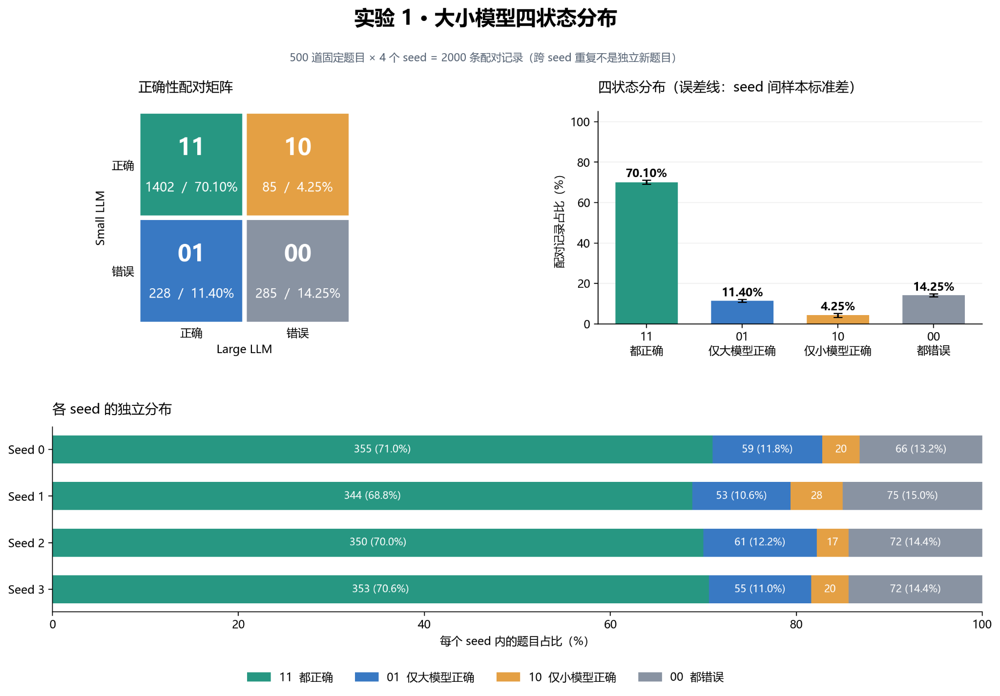
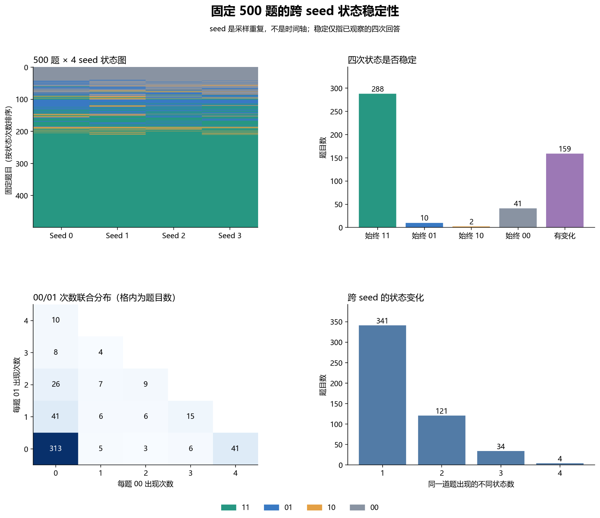
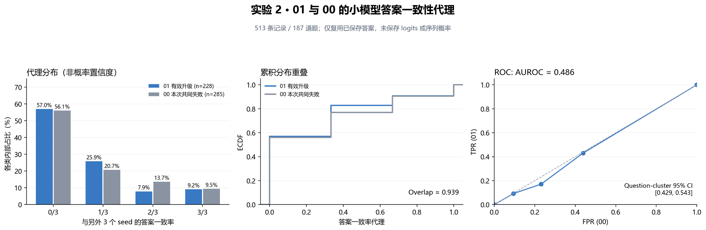

# Week: 8
# Period: 2026.10.19 —— 2026.10.25
# Person: 叶顺
## Done
1. 简单过了一遍智能体的理论知识
2. 系统学习了一点博弈论
3. 继续阅读了模型协同的文献：RouteWeaver、TokenRouter、JEV-as-a-Judge
4. 了解了一下关于JEV的知识
5. 初步写了一点大小模型协同的研究综述
5. 有点想法，做了两个有关大小模型协同的探究实验

    **（1）动机**

    现有大小模型协同方法，无论是问题级、步骤级还是Token级路由，大多遵循“小模型能力不足时升级大模型”的思路。但小模型无法解决的问题，大模型也可能无法解决，此时升级只会增加推理开销，无法带来性能收益。因此，考虑能否从预测小模型是否能解决问题，转向预测升级大模型是否真正有效。

    **（2）做法**
    
    *实验1：四状态分布分析。 在MATH-500上，使用大小模型分别回答500道题，重复4个Seed，将结果划分为11（都正确）、01（仅大模型正确）、10（仅小模型正确）、00（都错误），分析升级收益及跨Seed稳定性。

    *实验2：有效升级识别。 针对01和00两类样本，利用小模型跨Seed答案一致性作为代理指标，检验能否区分有效升级与无效升级。

    **（3）结果**

    实验1：11占70.10%，01占11.40%，10占4.25%，00占14.25%。在小模型回答错误的记录中，55.56%即使升级大模型也无法解决；68.2%的题目在4个Seed中状态保持一致。

实验2：01与00的答案一致性分布高度重叠，AUROC仅为0.486，说明小模型答案一致性基本无法有效区分升级是否有收益。

    **（4）启发**

     小模型回答不正确，并不意味着大模型能够解决；小模型输出是否稳定，也不等于升级是否有效。因此，后续考虑预测大小模型的相对能力差异及升级带来的预期收益，识别“值得升级”和“升级也无效”的任务，在尽量保证推理准确率的同时减少不必要的大模型调用。下一步准备进一步验证模型内部置信度能否区分这两类任务。

## Todo
1. 准备继续学习一点博弈论
2. 深入阅读下有关JEV的文章，看有没有能够结合利用的地方
3. 继续下一步探究实验：（1）能不能利用原有Steer原生置信度进行区分00和01；（2）还有哪些其他特征能够预测大模型的挽救能力； （3）应该根据总体预期的升级收益进行路由以节省算力，而不是题目难度 （4）换其他的数据集进行验证数据分布特征
4. 继续阅读文献，融合自己的想法进入综述

## 遇到的问题
- 
